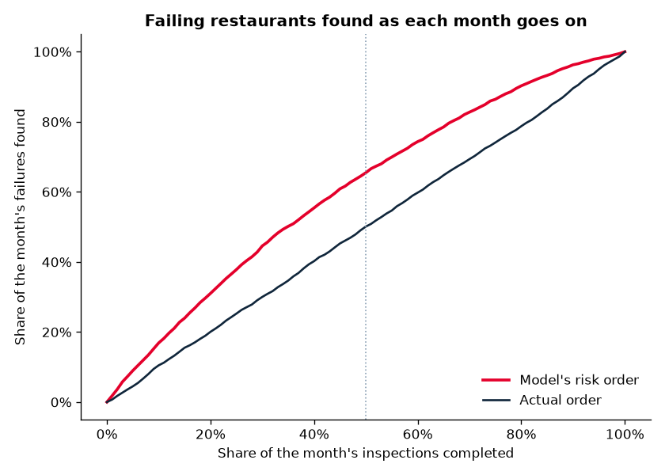

# Restaurant Inspection Risk

Predicting which Chicago restaurants are most likely to fail their next health inspection, so inspectors can visit the riskiest ones first.

App link: https://restaurant-inspection-risk.streamlit.app/ 

**Status:** Step 1 (data collection, cleaning, and exploration), step 2 (features and first models), step 3 (outside data), step 4 (business simulation), and step 5 (Streamlit app) complete.

## The business question
Health departments can't inspect every restaurant at once. If they could rank restaurants by risk, they would catch dangerous kitchens sooner with the same number of inspectors. Chicago's public health department has built a version of this model; this project recreates the idea and extends it with text analysis of inspector notes.

## Data
- **Chicago Food Inspections** (Chicago Data Portal, dataset `4ijn-s7e5`): every food inspection in the city, with the result, the restaurant's license number and location, and the inspector's comments on each violation.
- **Chicago 311 Service Requests** (Chicago Data Portal, dataset `v6vf-nfxy`): rodent, sanitation, and restaurant complaints, counted near each restaurant in the days before each inspection.
- **Daily weather** (Open-Meteo historical weather API): temperature and precipitation around each inspection date.

## How to run
```bash
python3 -m venv .venv
source .venv/bin/activate
pip install -r requirements.txt

python src/download_data.py   # downloads the raw data (a few minutes)
python src/clean.py           # cleans it -> data/processed/inspections_clean.csv
python src/eda.py             # charts -> reports/figures/, summary -> reports/eda_summary.md
python src/features.py        # model features -> data/processed/features.csv
python src/train.py           # baseline + models -> reports/model_results.md

# Step 3: outside data
python src/download_external.py                  # 311 complaints + weather
python src/external_features.py                  # -> data/processed/features_plus.csv
python src/train.py --features features_plus.csv # -> reports/model_results_plus.md

# Step 4: business impact simulation
python src/simulation.py      # -> reports/simulation_results.md

# Step 5: interactive app
streamlit run app.py
```

## Project structure
```
restaurant-inspection-risk/
├── data/
│   ├── raw/                 # downloaded data (not committed to git)
│   └── processed/           # cleaned data (not committed to git)
├── models/                  # saved models (not committed to git)
├── notebooks/               # exploration notebooks
├── reports/
│   ├── figures/             # all charts
│   ├── eda_summary.md       # exploration findings
│   ├── model_results.md     # model vs. baseline
│   └── simulation_results.md # business impact
├── src/
│   ├── download_data.py     # step 1a: download
│   ├── clean.py             # step 1b: clean
│   ├── eda.py               # step 1c: explore
│   ├── features.py          # step 2a: features
│   ├── train.py             # step 2b: models
│   ├── download_external.py # step 3a: 311 + weather
│   ├── external_features.py # step 3b: outside-data features
│   └── simulation.py        # step 4: business impact
├── app.py                   # step 5: Streamlit app
└── requirements.txt
```

## Cleaning decisions
- **Restaurants only:** kept facility types containing "restaurant."
- **Real outcomes only:** kept Pass, Pass w/ Conditions, and Fail. Dropped "Out of Business," "No Entry," and similar results, since no inspection actually happened.
- **Inspection categories:** grouped dozens of inspection type spellings into routine (canvass), complaint, re-inspection, license, and other.
- **Violations:** parsed the violations text into a count, the list of violation numbers, and the inspector comments (saved for NLP later).
- **Food code change:** Chicago adopted a new food code on July 1, 2018, which renumbered violations. The `new_food_code` column marks inspections after that date.
- **No data leakage:** the "previous result" columns use only a restaurant's earlier inspections. The current inspection's violations are never used to predict its own result.

## Findings
See [reports/eda_summary.md](reports/eda_summary.md).

## Results
Tested on 15,363 routine inspections from January 2024 to October 2026, using a model trained only on earlier years.

**Business impact** ([full report](reports/simulation_results.md)): each month keeps its real inspection dates, and the model only changes which restaurant gets visited first.
- Failing restaurants would have been found **3.2 days sooner on average**, for a total of **11,381 fewer days** that failing kitchens stayed open before an inspector arrived.
- By the middle of each month, inspectors would have found **65.5%** of that month's failures, compared to **50.1%** in the actual order.



**Model vs. baseline** ([full report](reports/model_results.md)): with the same number of flags as the simple rule "failed its last routine inspection," the model finds **1,155** failing restaurants vs. **934** (**+221**, about 24% more).

**What mattered:** a restaurant's average number of past violations was the strongest signal, more than whether it passed or failed. Restaurants that keep barely passing with many violations are a warning sign the pass/fail result hides.

**What didn't:** nearby 311 rodent and sanitation complaints and weather barely changed results ([report](reports/model_results_plus.md)), so a restaurant's own track record carries most of the signal. Logistic regression performed about as well as gradient boosting.

