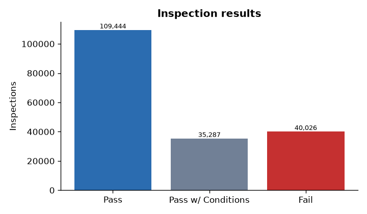
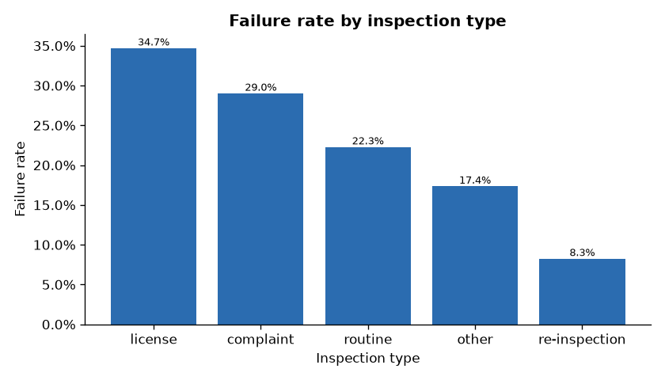
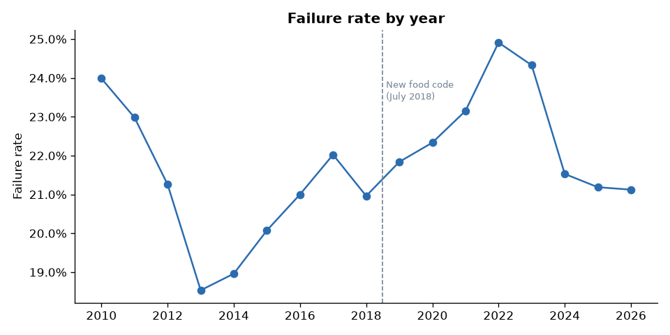
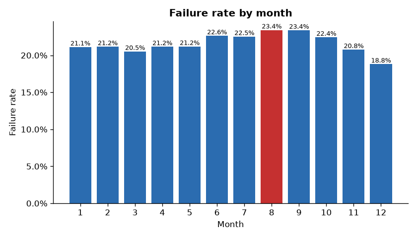
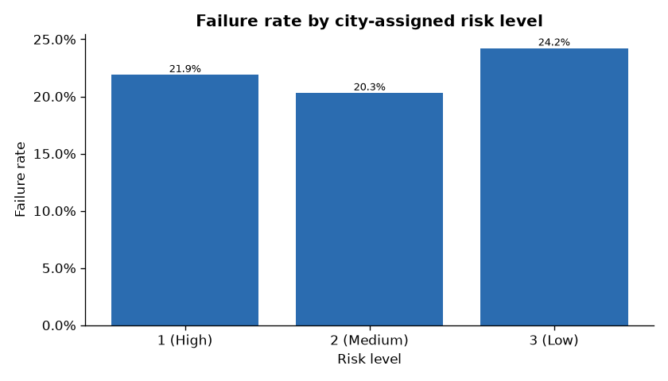
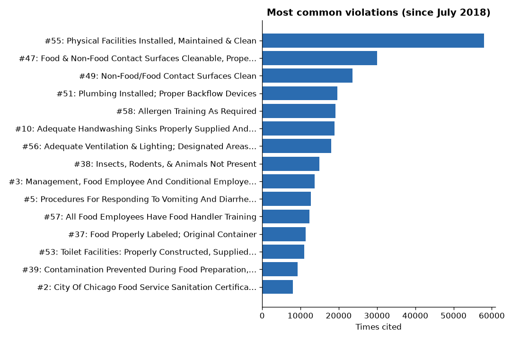
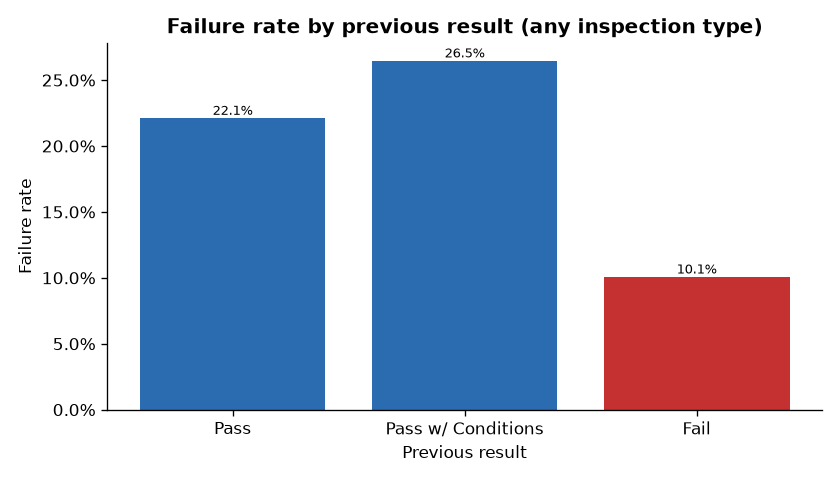
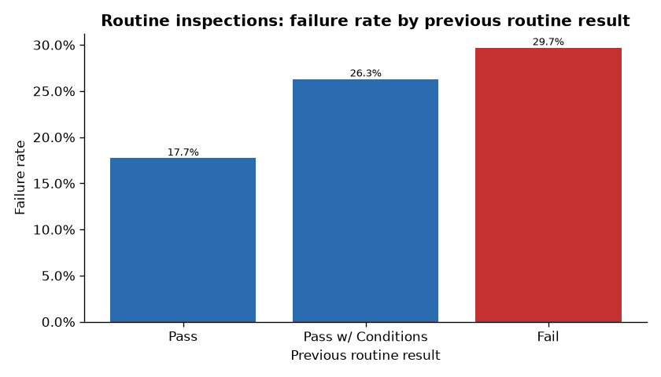

# Exploratory Data Analysis: Chicago Restaurant Inspections

## Overview
- **184,757** restaurant inspections of **27,117** restaurants
- Dates: Jan 2010 to Oct 2026
- Overall failure rate: **21.7%**

## Results

- Pass: 109,444 (59.2%)
- Pass w/ Conditions: 35,287 (19.1%)
- Fail: 40,026 (21.7%)

## By inspection type

- license: 34.7% of 20,932 inspections
- complaint: 29.0% of 30,145 inspections
- routine: 22.3% of 91,338 inspections
- other: 17.4% of 1,636 inspections
- re-inspection: 8.3% of 40,706 inspections

Routine (canvass) inspections are the ones a risk model would help schedule. Complaint and re-inspections behave differently, so model them separately or as a feature.

## Over time

Watch for a shift around July 2018, when Chicago adopted a new food code. Consider training only on post-2018 data, or adding a `new_food_code` feature.

## Seasonality

- Highest month: 8 (23.4%); lowest: 12 (18.8%)

## By city risk level

- Risk 1 (High): 21.9%
- Risk 2 (Medium): 20.3%
- Risk 3 (Low): 24.2%

## Most common violations

1. #55: Physical Facilities Installed, Maintained & Clean (57,975)
2. #47: Food & Non-Food Contact Surfaces Cleanable, Prope… (30,051)
3. #49: Non-Food/Food Contact Surfaces Clean (23,629)
4. #51: Plumbing Installed; Proper Backflow Devices (19,640)
5. #58: Allergen Training As Required (19,132)
6. #10: Adequate Handwashing Sinks Properly Supplied And… (18,936)
7. #56: Adequate Ventilation & Lighting; Designated Areas… (18,048)
8. #38: Insects, Rodents, & Animals Not Present (14,967)
9. #3: Management, Food Employee And Conditional Employe… (13,653)
10. #5: Procedures For Responding To Vomiting And Diarrhe… (12,671)
11. #57: All Food Employees Have Food Handler Training (12,382)
12. #37: Food Properly Labeled; Original Container (11,407)
13. #53: Toilet Facilities: Properly Constructed, Supplied… (11,022)
14. #39: Contamination Prevented During Food Preparation,… (9,254)
15. #2: City Of Chicago Food Service Sanitation Certifica… (8,012)

## Does the past predict the future?

- After a previous **Pass**: 22.1% fail
- After a previous **Pass w/ Conditions**: 26.5% fail
- After a previous **Fail**: 10.1% fail

Caution: this mixes inspection types. After a fail, the next inspection is usually a re-inspection, which rarely fails, so this chart understates how much a past failure matters. The routine-only comparison below is the fair one.

## Fair comparison: routine vs. previous routine

- After a previous routine **Pass**: 17.7% fail (41,639 inspections)
- After a previous routine **Pass w/ Conditions**: 26.3% fail (16,469 inspections)
- After a previous routine **Fail**: 29.7% fail (15,601 inspections)
- First routine inspection on record: 22.8% fail
- All routine inspections with a previous routine: 22.2% fail

Baseline model to beat: flag a restaurant as high risk if it failed its last routine inspection.
