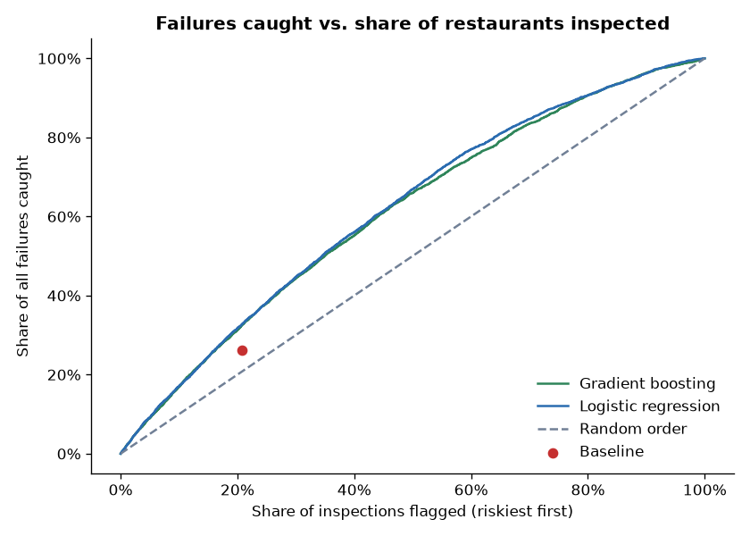
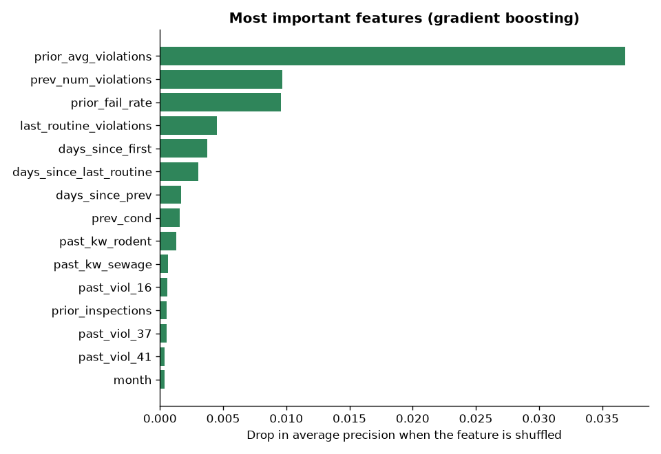

# Model Results: Predicting Restaurant Inspection Failures

- **Train:** 25,494 routine inspections, Jul 2018 to Dec 2023
- **Test:** 15,363 routine inspections, Jan 2024 to Oct 2026 (3,565 failures, 23.2%)
- **Features:** 47

## Same workload comparison
Each approach flags the same **3,184** inspections the baseline flags.

| Model | Precision | Recall | ROC AUC | Avg precision |
|---|---|---|---|---|
| Baseline: failed last routine | 29.3% | 26.2% | — | — |
| Logistic regression | 36.6% | 32.7% | 0.652 | 34.3% |
| Gradient boosting | 36.3% | 32.4% | 0.644 | 33.7% |

**Logistic regression** catches **32.7%** of failures vs. **26.2%** for the baseline, about **232 more failing restaurants** found with the same number of flags.

If inspectors visited the riskiest 20% of restaurants first, the model would catch **31.8%** of all failures (random order would catch about 20%).

## Gains curve

## Most important features

1. `prior_avg_violations` (0.0368)
2. `prev_num_violations` (0.0097)
3. `prior_fail_rate` (0.0096)
4. `last_routine_violations` (0.0045)
5. `days_since_first` (0.0037)
6. `days_since_last_routine` (0.0030)
7. `days_since_prev` (0.0017)
8. `prev_cond` (0.0016)
9. `past_kw_rodent` (0.0013)
10. `past_kw_sewage` (0.0007)
11. `past_viol_16` (0.0006)
12. `prior_inspections` (0.0005)
13. `past_viol_37` (0.0005)
14. `past_viol_41` (0.0004)
15. `month` (0.0004)
