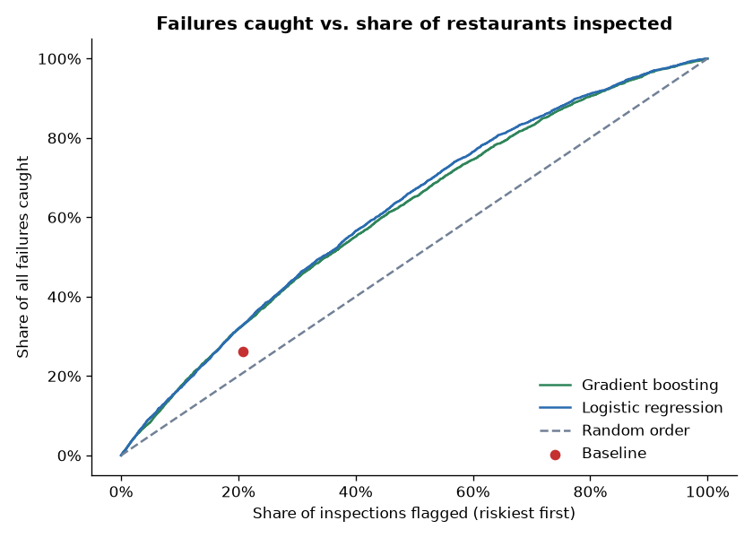
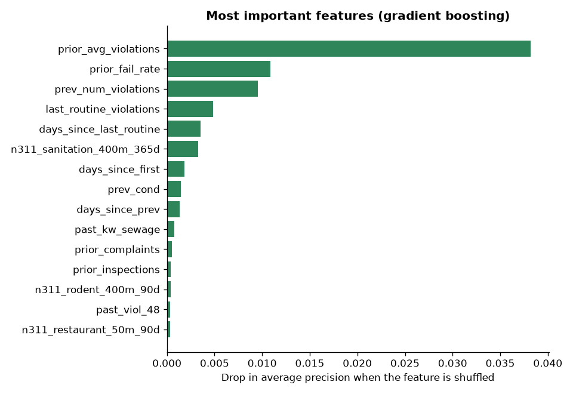

# Model Results: Predicting Restaurant Inspection Failures

- **Train:** 25,494 routine inspections, Jul 2018 to Dec 2023
- **Test:** 15,363 routine inspections, Jan 2024 to Oct 2026 (3,565 failures, 23.2%)
- **Features:** 57 (from `features_plus.csv`)

## Same workload comparison
Each approach flags the same **3,184** inspections the baseline flags.

| Model | Precision | Recall | ROC AUC | Avg precision |
|---|---|---|---|---|
| Baseline: failed last routine | 29.3% | 26.2% | — | — |
| Logistic regression | 36.7% | 32.8% | 0.653 | 34.4% |
| Gradient boosting | 36.7% | 32.7% | 0.643 | 33.6% |

**Logistic regression** catches **32.8%** of failures vs. **26.2%** for the baseline, about **236 more failing restaurants** found with the same number of flags.

If inspectors visited the riskiest 20% of restaurants first, the model would catch **31.9%** of all failures (random order would catch about 20%).

## Gains curve

## Most important features

1. `prior_avg_violations` (0.0382)
2. `prior_fail_rate` (0.0109)
3. `prev_num_violations` (0.0095)
4. `last_routine_violations` (0.0049)
5. `days_since_last_routine` (0.0035)
6. `n311_sanitation_400m_365d` (0.0033)
7. `days_since_first` (0.0018)
8. `prev_cond` (0.0014)
9. `days_since_prev` (0.0013)
10. `past_kw_sewage` (0.0007)
11. `prior_complaints` (0.0005)
12. `prior_inspections` (0.0004)
13. `n311_rodent_400m_90d` (0.0004)
14. `past_viol_48` (0.0003)
15. `n311_restaurant_50m_90d` (0.0003)
